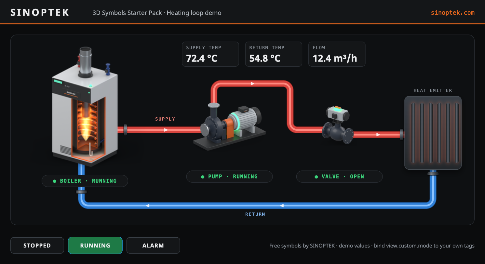

# SINOPTEK 3D Symbols - Starter Pack



**Download:** `sinoptek-3d-symbols-images.zip` (images) and `sinoptek-3d-symbols.zip` (the two Perspective views as a project export), or browse the folders in this repository.

Three 3D-rendered equipment symbols for SCADA / HMI / BMS screens, free to use in your projects.
Made by SINOPTEK - https://sinoptek.com

> What has been tested: Ignition 8.3.10, in a Perspective session (Chrome). The PNG images display correctly,
> the animated PNG (APNG) plays inside the Perspective Image component, and the two views in `perspective-views/`
> (`Symbol` and `Demo`, including the three buttons of `Demo`) work as delivered.
> Not tested: importing through the Designer (Image Management upload, pasting view JSON), Vision, and any
> Ignition version earlier than 8.3.10 (including 8.1).

## What is included

| Symbol | View | Files (prefix) | States |
|---|---|---|---|
| Centrifugal pump | 3D exterior | `centrifugal-pump-` | stopped, running, alarm |
| On/off valve (actuated) | 3D exterior | `on-off-valve-` | closed, open, alarm |
| Gas condensing boiler | 3D cutaway (section showing burner and coil) | `gas-boiler-` | stopped, running, alarm + 3 running frames |

- `images/exchange/sinoptek-3d-symbols/` - 16 PNG files in one folder, 256 x 256 px, transparent background:
  - 12 fixed images, named `<symbol>-<state>.png`. All states of a symbol share the same framing, so swapping
    the image does not make the symbol jump.
  - 4 animated PNG (APNG): `-alarm-blink` for each symbol and `gas-boiler-running-animated.png` (the flame moves).
    If you prefer not to use APNG, cycle the frames (see below).
- `perspective-views/` - two Perspective views as `view.json`: `Symbol` (one embeddable symbol) and `Demo`
  (a small interactive heating loop). See "The Demo view" below and the note inside the folder.
- `manifest.json` - machine-readable list of symbols, states and files.
- `LICENSE` - MIT licence.

Not included: running animation for the pump and the valve (their "running"/"open" is a single image),
the exterior view of the boiler, SVG/vector versions, other sizes and 2D elevation views.

State colour convention: light off = stopped/closed, green = running/open, red = alarm. In the boiler the flame
is visible only when running. In the three running frames of the boiler the flame has been accentuated (its
brightness and height change from frame to frame) so that the animation is noticeable at 256 px.

Branding: the only brand on the images is the small SINOPTEK nameplate that is part of each piece of equipment.
No caption, signature or watermark is added on top of the images.

## Use in Perspective

1. Designer > Tools > Image Management. Create the folders `exchange/sinoptek-3d-symbols` and upload all the PNG files
   from `images/exchange/sinoptek-3d-symbols/`.
2. Add an Image component to a view. Set `props.source` to the image path prefixed with `/system/images`, e.g.
   `/system/images/exchange/sinoptek-3d-symbols/centrifugal-pump-stopped.png`.
3. To follow a tag, put an Expression binding on `props.source`. Example with two boolean tags
   (replace the tag paths with yours):

   ```
   "/system/images/exchange/sinoptek-3d-symbols/centrifugal-pump-"
   + if({[default]Pump1/Alarm}, "alarm", if({[default]Pump1/Running}, "running", "stopped"))
   + ".png"
   ```

   With one integer status tag (0 = stopped, 1 = running, 2 = alarm):

   ```
   "/system/images/exchange/sinoptek-3d-symbols/gas-boiler-"
   + case({[default]Boiler1/Status}, 1, "running", 2, "alarm", "stopped")
   + ".png"
   ```

4. Running animation for the boiler: use `gas-boiler-running-animated.png`, or cycle the three frames, for example

   ```
   "/system/images/exchange/sinoptek-3d-symbols/gas-boiler-running-frame-"
   + ((getSecond(now(1000)) % 3) + 1) + ".png"
   ```

The `Symbol` view (image path built from its `symbol` and `state` parameters with an expression binding) has been
tested. The tag expressions above follow the Ignition expression language but have not been run against real tags.

## The Demo view

`Exchange/Sinoptek 3D Symbols/Demo` is a ready-made screen of 1120 x 610 px that shows the three symbols working
together as a small heating loop:

- header with SINOPTEK, the pack name and sinoptek.com;
- the cutaway boiler, the pump and the valve, drawn to scale with each other (300, 180 and 100 px). The pump
  image has its suction on the left, facing the boiler;
- supply (red) and return (blue) pipes with rounded elbows, flanges and flow arrows: the supply leaves the boiler,
  enters the pump suction, leaves through the pump discharge at the top, crosses over and comes down into the
  valve, and continues to a heat emitter; the return is a blue U back to the boiler. Pipes and emitter are drawn
  with ordinary Perspective components; the emitter is not one of the symbols of the pack;
- three readings (supply temperature, return temperature, flow). They are fixed demonstration values, one set per
  mode, not live data;
- a status label under each piece of equipment;
- three buttons: STOPPED, RUNNING, ALARM.

Everything depends on one custom property of the view, `view.custom.mode`, which takes the text values `stopped`,
`running` or `alarm` (the view opens in `running`). Each button writes it with a one-line script
(`self.view.custom.mode = 'running'`); images, labels, colours and readings read it through expression bindings.
The mode applies to the three pieces of equipment at once:

| mode | boiler | pump | valve |
|---|---|---|---|
| `stopped` | `gas-boiler-stopped.png` | `centrifugal-pump-stopped.png` | `on-off-valve-closed.png` |
| `running` | `gas-boiler-running-animated.png` | `centrifugal-pump-running.png` (single image) | `on-off-valve-open.png` |
| `alarm` | `gas-boiler-alarm-blink.png` | `centrifugal-pump-alarm-blink.png` | `on-off-valve-alarm-blink.png` |

Requirement: the 16 images of the pack must be in Image Management under `exchange/sinoptek-3d-symbols`
(the view uses fixed and animated images from that folder).

To drive it from your plant instead of the buttons, bind `view.custom.mode` to your own tag or to an expression
that returns `"stopped"`, `"running"` or `"alarm"`, remove the buttons (or make the binding bidirectional), and
replace the three readings with your own tags. This tag-driven variant has not been tested by us; what has been
tested is the view as delivered, with the three buttons changing the three symbols, their labels, the readings
and the highlighted button.

## Use in Vision

1. Upload the same PNG files with Tools > Image Management.
2. Add an Image component and bind its Image Path property with the same kind of expression. In Vision the path is
   the Image Management path without the `/system/images/` prefix, e.g.
   `"exchange/sinoptek-3d-symbols/centrifugal-pump-" + if({[default]Pump1/Running}, "running", "stopped") + ".png"`.

Not tested in Vision. APNG animation is not expected to play in Vision; use the frames.

## Licence

MIT licence (see `LICENSE`). You may use, copy, modify and redistribute these files, also in commercial projects,
as long as the copyright notice and the licence text are kept with them. They are provided "as is", without warranty.
The licence covers the files of this package only.

## More symbols

This pack is a small standalone selection: together the three symbols are enough for a small heating loop
(boiler + pump + valve). The full SINOPTEK libraries (boilers, cooling plant, modular air handling
units, industrial process equipment; 3D, cut-away and 2D views; several sizes; custom symbols on request) are at
https://sinoptek.com - contact: comercial@sinoptek.com
